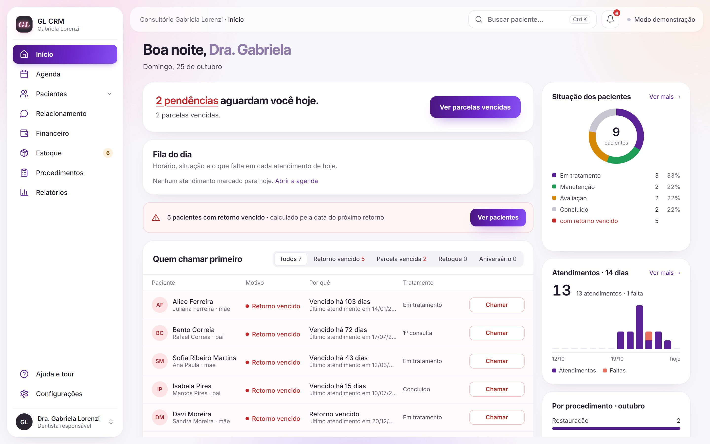

# GL CRM

[](https://github.com/Matheuscfs/gl-crm/actions/workflows/ci.yml)

A practice-management CRM for a dental clinic (paediatric, adult and facial aesthetics): schedule, patient records with a tooth-by-tooth odontogram, clinical documents, billing with PIX, inventory and WhatsApp automation. One React + TypeScript app on Supabase that runs on the front-desk computer, the reception tablet and the dentist's phone (installable PWA).



**Try it locally without a backend:** with no `.env`, `npm run dev` opens in demo mode with fictional patients, appointments and payments.

## What's inside

| | |
|---|---|
| [`src/pages/Dashboard.tsx`](src/pages/Dashboard.tsx) | Home: what is pending today, the day's queue, and who to call first (overdue check-up, overdue instalment, touch-up, birthday). |
| [`src/pages/Agenda.tsx`](src/pages/Agenda.tsx) | Week, day and month views, drag to reschedule, conflict and opening-hours checks, online booking requests, Google Calendar sync. |
| [`src/pages/patient/`](src/pages/patient/) | The patient record: anamnesis, 2D odontogram by tooth surface (primary, mixed and permanent dentition) and a 3D view, treatment notes with an edit trail, plans and quotes, payments, private attachments (X-rays), before/after, facial map with product, batch and expiry. |
| [`src/pages/documents/`](src/pages/documents/) | Clinical record, consent forms, prescriptions (including controlled substances), sick notes and attendance declarations, filled with the clinic's data. |
| [`src/lib/pix.ts`](src/lib/pix.ts) | PIX "copia e cola" generated in the browser (Bacen EMV BR Code), no payment provider needed. |
| [`src/lib/money.ts`](src/lib/money.ts) | Money parsing that accepts what people actually type in Brazil, including the tablet's decimal keypad, which only has a dot. |
| [`src/store.tsx`](src/store.tsx) | App state and persistence: changes show at once and are undone if the database refuses them. |
| [`supabase/functions/`](supabase/functions/) | Edge Functions: WhatsApp (official Meta API) reminders and replies, Asaas billing webhooks, scheduled automation. |
| [`supabase/tests/database/access.test.sql`](supabase/tests/database/access.test.sql) | Who can read and write what, tested against the real database policies. |

## The interesting part: who gets to see a patient's record

A dental record holds health data, so access cannot depend on the front end hiding a button. Every rule lives in the database as row-level security, and the database enforces it on every request:

- Row-level security is on for **every** table, and a test fails if a new table ships without it.
- Someone without an account cannot read patients or booking requests. Someone who signs up but is not on the clinic's team sees no patients, cannot create one and cannot add themselves to the team.
- The first person to sign in after the access migration becomes the administrator; everyone after that has to be added to the team.
- A member who is deactivated loses access at once.
- The public online-booking page can see the free slots and request one, and nothing else.

These are not just written down: [`access.test.sql`](supabase/tests/database/access.test.sql) switches to the role and JWT claims Supabase would set for each kind of visitor and checks 26 assertions in a transaction that is rolled back at the end. CI runs it against a real Postgres on every push.

## Tests and CI

- **67 unit tests** (Vitest) on the logic that handles money and dates: money parsing, PIX payloads, opening hours, check-up due dates, instalments, CSV and receipts, automation rules. Writing them found and fixed three bugs.
- **26 database assertions** (pgTAP) on access control, run with `supabase test db`.
- **CI** on every push and pull request: lint with zero warnings, typecheck (app and tests), tests with coverage, production build, and the database job.

## Run it

```bash
npm install
npm run dev        # demo mode with fictional data when there is no .env
npm test           # unit tests
npm run lint
npm run build      # typecheck + production build
```

Requires Node 22 or newer. The database tests need the [Supabase CLI](https://supabase.com/docs/guides/cli) and Docker: `supabase db start && supabase test db`.

### Connecting a real Supabase project

1. Copy `.env.example` to `.env`, fill in `VITE_SUPABASE_URL` and `VITE_SUPABASE_PUBLISHABLE_KEY` (and the Google variables for calendar sync), and set `VITE_DEMO_DATA=0`.
2. Apply `supabase/migrations/` in order, skipping `0002_seed` and `0008_seed_estetico`, which are demo data.
3. Sign in once: the first account after migration 0027 becomes the administrator.
4. For WhatsApp, billing and scheduled automation, follow [`supabase/functions/README.md`](supabase/functions/README.md).

## Simplifications

- **One clinic per deployment.** Data is not split by clinic yet; a second clinic needs its own Supabase project.
- **WhatsApp through the official API only.** Automation needs a Meta Business account and approved message templates; there is no unofficial fallback.
- **The 3D odontogram is drawn in code.** Teeth are modelled with Three.js by type (incisor, canine, premolar, molar), not from a scan, and the view is loaded on demand so it does not weigh on the other screens.

## Em português

CRM para consultório odontológico (odontopediatria, adulto e harmonização): agenda, ficha do paciente com odontograma por face, documentos clínicos (receituário, atestado, TCLE), financeiro com PIX e boleto, estoque com lote e validade, e automação pelo WhatsApp oficial (confirmação 24 h antes, cobrança, retorno, aniversário). React + TypeScript sobre Supabase, instalável como PWA no tablet da recepção. Quem vê o quê é decidido pelo banco (RLS) e testado no CI. Sem `.env`, `npm run dev` abre em modo demonstração com dados fictícios.
